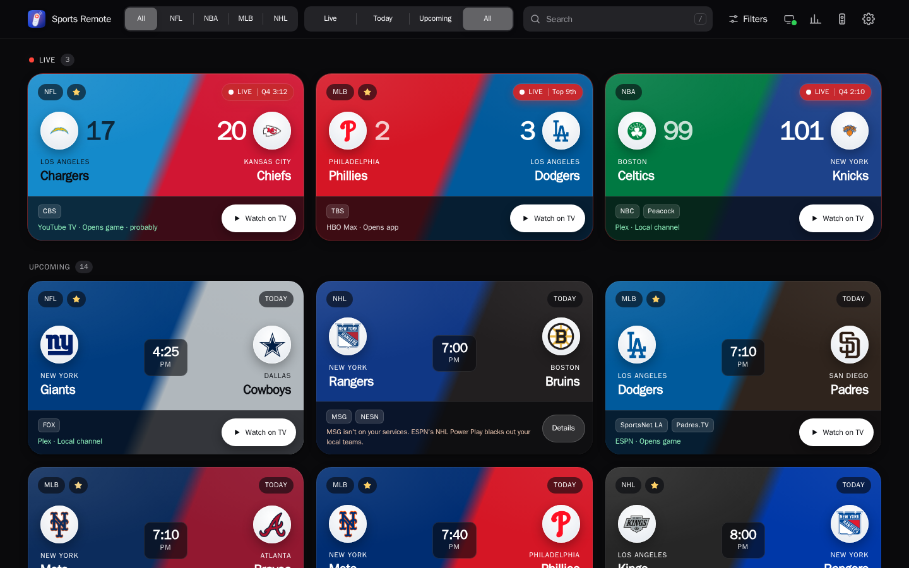
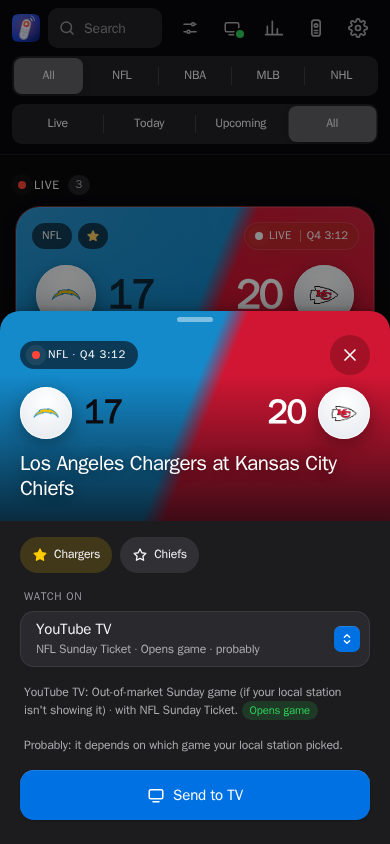
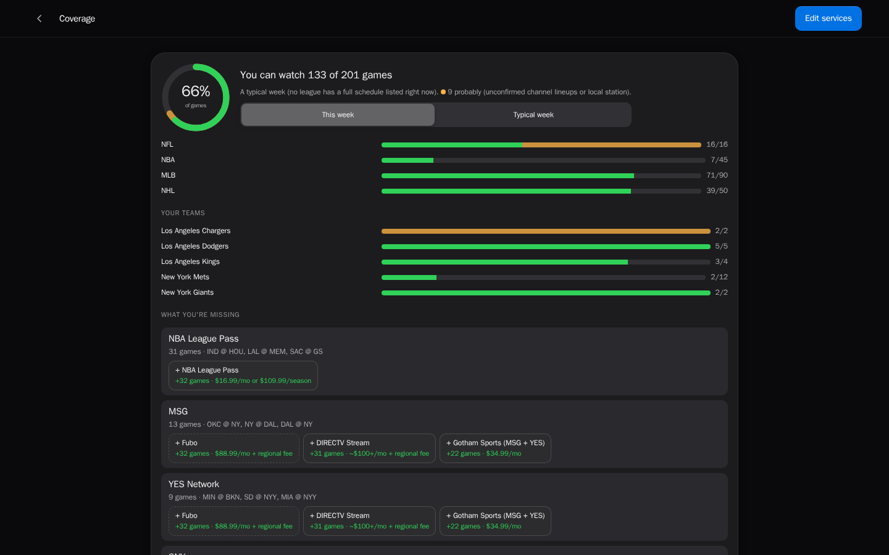
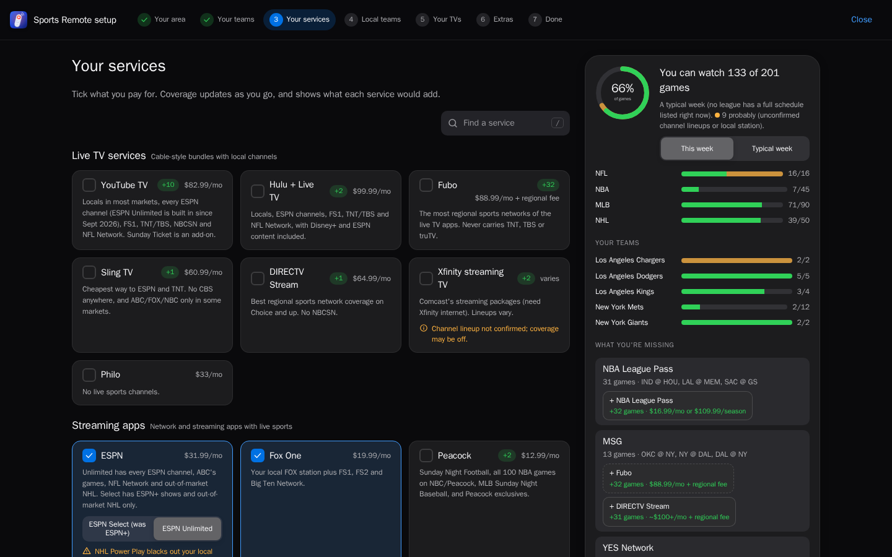

# Sports Remote

**Find the game, see if you can watch it, and put it on your TV from your phone.**

Sports Remote shows every live and upcoming NFL, NBA, MLB and NHL game. For each one it tells you whether your TV services carry it where you live. One tap opens the game on your Fire TV or Google TV in the right app.

It's self-hosted: one small server on your home network (a Raspberry Pi, mini PC or NAS) that every phone and tablet in the house can use.



## Features

- **Every game, your teams first.** Live scores, start times, and the networks each game is on. Search by team, city or nickname, and filter by league, time or network.
- **Knows what you can watch.** Tell it where you live and which services you have. Each game then shows which app it's on, or why you can't watch it: blacked out, a national exclusive, or a channel you don't have.
- **Coverage before you subscribe.** See what share of games you can watch, per league and per team, and how many more each service would add.
- **One tap to the TV.** Sports Remote opens the right app on the TV, and goes straight to the game when the app allows it. Otherwise it shows the last steps, with a remote on your phone.
- **A real remote.** A d-pad, OK, Back, Home, play/pause and volume, with presses landing on the TV almost instantly.
- **Made for a household.** Add every TV in the house. Sign in with a shared PIN, separate accounts for each person, or your own sign-in service.

<table>
  <tr>
    <td width="28%"></td>
    <td><br></td>
  </tr>
  <tr>
    <td align="center">Send a game to the TV</td>
    <td align="center">Coverage, and picking your services in setup</td>
  </tr>
</table>

## Getting started

You need an always-on Linux machine with Docker, on the same network as your TV.

```sh
mkdir -p ~/sports-remote/data && cd ~/sports-remote
curl -fsSLO https://raw.githubusercontent.com/jwizenfeld04/Sports-Remote/main/deploy/docker-compose.yml
docker compose up -d
docker compose logs | grep setup_required
```

The last command prints a one-time setup link. Open it on your phone or computer, and the setup wizard walks you through:

1. **Sign-in.** Choose how people in your home get in.
2. **Your area and teams.** These decide your local channels, your local teams and what's blacked out.
3. **Your services.** Tick what you pay for. The coverage panel updates as you go.
4. **Your TVs.** Turn on debugging in the TV's developer settings, then connect from the wizard. The [TV setup guide](docs/tv-setup.md) has the steps for each device.

You can run it without Docker too (Debian, Ubuntu or Raspberry Pi OS with systemd), and reach it securely away from home. See the **[hosting guide](docs/hosting.md)**.

## How it works

```
 Phone or tablet                    Sports Remote server                         TV
┌───────────────┐  HTTPS / Wi-Fi  ┌──────────────────────────────────┐   ADB   ┌──────────────┐
│ Web app       │ ──────────────▶ │ 1. Games      ESPN schedule      │ ──────▶ │ Fire TV or   │
│ (installable) │ ◀────────────── │ 2. Coverage   your area+services │  Wi-Fi  │ Google TV    │
└───────────────┘  live updates   │ 3. Launch     app catalog        │         └──────────────┘
                                  └──────────────────────────────────┘
```

1. **Games.** The server reads ESPN's public scoreboards for all four leagues. It pushes score and status changes to open phones as they happen.
2. **Coverage.** Each game's TV listing is checked against your household: your metro area, your local teams, and the services you have. National exclusives, regional sports networks, out-of-market packages, blackouts and local broadcast stations are all taken into account. The rules are in [docs/coverage.md](docs/coverage.md).
3. **Launch.** When you tap a game, the server ranks the apps that can show it on that TV, then controls the TV over ADB, Android's built-in debugging connection. Some apps can open straight to a game. For apps that can't (YouTube TV, Prime Video, and Plex for antenna setups), it can work through the app's menus with remote presses. It reads the screen after each step, and only presses play once the right teams are on screen.

The server only ever sends the TV a fixed set of commands, and everything stays on your network. [docs/ARCHITECTURE.md](docs/ARCHITECTURE.md) covers the design in detail.

## Supported TVs and services

**TVs:**
- Amazon Fire TV: sticks, Cube and Fire TV smart TVs.
- Google TV: Google TV Streamer, Chromecast with Google TV, and Google TV smart TVs.
- Other Android TV devices, such as the NVIDIA Shield.

Roku, Apple TV, Samsung and LG TVs, and the newest Vega OS Fire TV sticks, aren't Android and can't be used. See the [TV setup guide](docs/tv-setup.md).

**Services:**
- **Live TV:** YouTube TV, Hulu + Live TV, Fubo, Sling, DIRECTV Stream.
- **Streaming:** ESPN, Fox One, Peacock, Paramount+, Prime Video, HBO Max, Apple TV, Netflix.
- **League packages:** NFL Sunday Ticket, NBA League Pass, MLB.TV, NHL Power Play.
- **Regional sports networks and team apps:** DAZN, Gotham Sports (MSG and YES), SNY, NESN 360, Marquee, CHSN+ and more.
- **Antenna:** free local channels, optionally through Plex, Channels, Tablo or HDHomeRun.

TV rights change every season. Corrections and new services are welcome; see [CONTRIBUTING.md](CONTRIBUTING.md).

## Project structure

```
lib/      Shared logic: ESPN parsing, the catalog of networks, services, apps and teams, coverage and ranking
server/   The Fastify server: API, sign-in, settings, TV control over ADB, pairing and discovery
web/      The React app: game list, remote, setup wizard, coverage page
test/     Unit, server and UI tests, a TV simulator, and browser tests
deploy/   Docker Compose file, systemd service and install script
docs/     Architecture, hosting, coverage rules and testing notes
```

## Development

Requires Node 22 or newer.

```sh
npm ci
npm run dev:server     # the API on :8787
npm run dev            # the web app on :5173
npm test               # all tests; no TV needed
npm run test:e2e       # browser tests
```

The tests use a fake `adb` and a simulated TV, so you can work on everything, including the screen-reading launches, without a TV. [docs/testing-navigators.md](docs/testing-navigators.md) explains the simulator.

## Contributing and security

Bug reports, service and rights corrections, and pull requests are welcome. See [CONTRIBUTING.md](CONTRIBUTING.md). Please report security issues privately, as described in [SECURITY.md](SECURITY.md).

## License

[MIT](LICENSE)
